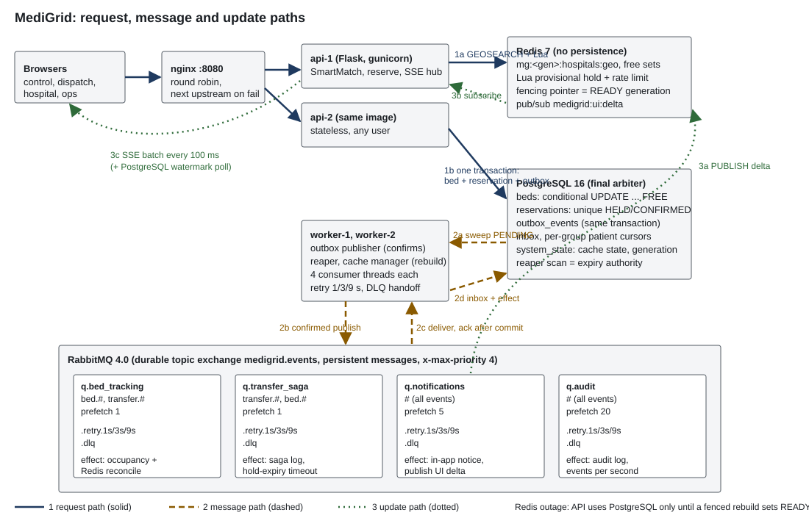

# MediGrid: City Emergency Bed and Patient Transfer Network (PS04)

## Problem

During an outbreak or a major accident, ambulance crews phone hospital after hospital looking for a free ICU bed.
Counts are stale, two ambulances get sent to the same last bed, transfer requests get lost when one hospital's system
is slow, critical requests wait behind paperwork, and control-room screens freeze in a surge. PS04 asks for a
city-wide network that finds and reserves the right bed in seconds and moves every admission, transfer and discharge
reliably between independent services, using RabbitMQ and Redis, on at least two application instances, with zero
double-allocated beds.

## What was built

- 40 synthetic hospitals and 4,597 beds (ICU, ventilator, general), with synthetic specialty capability tags.
- Dispatch with **MediGrid SmartMatch**: a deterministic rule filter that excludes hospitals lacking the mandatory
  capability for the selected synthetic condition, then reserves the nearest suitable free bed. It is not diagnosis
  or triage. Holds last 15 minutes and are released automatically if not confirmed.
- Hospital console: admit, discharge, transfer, confirm arrival; optimistic updates that roll back on 409; incoming
  transfer alerts with an accept countdown; keyboard navigation; connection indicator.
- Transfer saga between hospitals: completes fully or is reversed on reject or timeout.
- Live control-room map (inline SVG, no tiles), live over Server-Sent Events, with simulated ambulance positions.
- Operations page: events per second, queue depths, consumer lag, retries, DLQ with replay, search p95, free beds by
  type, invariants, cache state, and the judge chaos bar.
- Four independent consumers (bed tracking, transfer saga, notifications, audit), each with its own queue, retry
  queues, DLQ, inbox and per-patient ordering cursor.
- Simulators for the six judge scenarios, a surge simulator, a benchmark and an ambulance position simulator.

## Architecture



- **Request path.** Browser to nginx to either API instance. The API filters hospitals with SmartMatch, asks Redis
  (GEOSEARCH plus one Lua script) for a candidate bed and a provisional hold, then decides in one PostgreSQL
  transaction: conditional `UPDATE beds ... WHERE status='FREE'`, reservation row under a unique index on HELD or
  CONFIRMED, outbox row. Only a committed transaction is a reservation.
- **Message path.** Worker outbox publishers send committed rows to the durable topic exchange with publisher
  confirms and mandatory routing. Four queues with `x-max-priority 4` feed four consumer groups. Failures go to
  per-service 1, 3 and 9 s retry queues, then to a DLQ that operators can inspect and replay.
- **Update path.** The notification consumer publishes a delta on Redis pub/sub. Each API instance coalesces deltas
  for 100 ms and pushes one batch to its SSE clients. A PostgreSQL watermark poller covers lost pub/sub messages
  and Redis outages.

If Redis fails, every instance switches to SQL-only allocation (same SmartMatch predicate) until one worker
rebuilds Redis into a new generation and switches the shared state back to READY.

## Key decisions

Full list with alternatives and evidence: [docs/DECISIONS.md](docs/DECISIONS.md). One-page record:
[docs/DECISION_RECORD.md](docs/DECISION_RECORD.md). Judge Q&A: [docs/DEFENCE_NOTES.md](docs/DEFENCE_NOTES.md).

- PostgreSQL is the only allocation authority; Redis proposes (C2).
- Shared, fenced cache recovery with generations stored in PostgreSQL (C15).
- Transactional outbox; inbox per consumer group; per-group patient cursors (C8, C16, C21).
- Confirmed retry and DLQ handoff, acked only after the broker confirmed the copy (C20).
- Admission control per instance and fewer database round trips, after measurement (D-ADMIT, D-RT).

## Run it

Prerequisites: Docker Desktop (WSL2 on Windows), about 4 GB free RAM, port 8080 free.

```
cp .env.example .env          # then set passwords and a long SECRET_KEY
docker compose up --build -d  # migrate and seed run once, automatically
docker compose ps             # api-1, api-2 healthy; migrate and seed exited 0
```

Open http://localhost:8080. Reseed from scratch: `docker compose run --rm tools python -m app.seed --reset`.

**Demo identities.** There are no passwords. Click "Choose demo identity" in the header and pick a role and a user id:
`dispatcher` (dispatch page), `hospital` with a hospital id (that hospital's console), `operator` (everything,
including the ops page and chaos controls). The identity is a signed cookie, valid on both instances.

**LAN access.** Run `python tools/lan_url.py` on the laptop; it prints `http://<lan-ip>:8080/control`. On Windows,
allow inbound TCP 8080 for Docker Desktop in Windows Defender Firewall (Inbound Rules, New Rule, Port, TCP 8080,
Private networks). On macOS allow Docker in System Settings, Network, Firewall. Open the printed URL on a phone on
the same Wi-Fi. If the venue Wi-Fi blocks device-to-device traffic, use a phone hotspot.

**Ambulance positions** come from a simulator: `docker compose run --rm tools python -m sim.ambulances`.

**Tests:** `docker compose run --rm tools python -m pytest -q tests` (28 tests against the live stack).

## Pages

| Page | Purpose |
|---|---|
| `/control` | City map of 40 hospitals with OK/LOW/FULL shapes and free counts, filters by bed type, load and capability, ambulance layer, city totals |
| `/dispatch` | SmartMatch condition, bed type, priority, location; matched and excluded hospitals with reasons; plain-nearest comparison; hold countdown, confirm, cancel |
| `/hospital/<id>` | Bed grid (FREE circle, RESERVED striped diamond, OCCUPIED square, each with text), admit, discharge, transfer, confirm arrival, incoming transfer alerts with countdown |
| `/ops` | Metrics, queues, invariants, cache state transitions, DLQ viewer and replay, blocked patient streams, chaos bar |

## Demo runbook

Scenarios 1 to 4 have buttons on `/ops` (operator identity, `CHAOS_ENABLED=1`). Each also runs from a terminal with
the same code. Scenarios 5 and 6 need Docker commands, so the simulator prints when to run them.

| # | Run | Watch | Expected |
|---|---|---|---|
| 1 Last-bed stampede | ops button, or `docker compose run --rm tools python -m sim.stampede` | ops invariants, result card | exactly 1 holder of H-01's last ICU bed, 49 other beds or no-match, 0 double allocations, search p95 < 100 ms, one user gets 429 with Retry-After |
| 2 Flood then critical | ops button, or `... python -m sim.priority` | queue table: `q.transfer_saga` 0 consumers, then 10,001 messages | critical processed at position 1 |
| 3 Expiry | ops button, or `... python -m sim.expiry` | control map count for the hospital | bed FREE within 5 s of expiry, SSE update within 5 s |
| 4 Poison and crash | ops button, or `... python -m sim.poison` | DLQ viewer, worker restarts in `docker compose ps` | retries after 1, 3, 9 s then DLQ; crash before ack redelivered, guard sends to DLQ; replay processes once |
| 5 Broker restart | `docker compose run --rm tools python -m sim.broker_restart`, then in another terminal `docker compose restart rabbitmq` | ops: outbox pending rises then drains | every committed event processed once per group, 0 unresolved; ops button "Verify event parity" shows the table |
| 6 Instance stop and Redis | `docker compose run --rm tools python -m sim.failover`, then run each printed command: `docker compose stop api-1` (or api-2), `docker compose start api-1`, `docker compose pause redis` / `unpause redis`, `docker compose restart redis` | header badge: connection and mode; ops cache transitions | stream resumes on the other instance within 5 s; "Degraded safe mode"; new generation READY; 0 double allocations; SmartMatch never picks H-01 for cardiac |

Also: `python -m sim.smartmatch` (SmartMatch demonstration), `python -m sim.surge --ambulances 300 [--crash]`,
`python -m sim.bench --concurrency 300`.

## Measured results

Measured on 2026-11-13, Windows 11 Pro with Docker Desktop (WSL2), 16 logical CPUs, 16 GB RAM, everything on one
laptop. Raw JSON in `results/`, step-by-step record in [docs/BUILD_LOG.md](docs/BUILD_LOG.md).

| Target | Pass line | Measured | Result |
|---|---|---|---|
| Bed change visible city-wide | 2 s | 0.24 s from DB expiry to SSE batch through nginx | PASS |
| Bed search p95 | < 100 ms | idle 7.1 ms (n=200); 300 ambulances at 150 searches/s 14.1 ms (n=3,000); 50 simultaneous 76.0 ms | PASS |
| Bed search p95, 300 continuous closed-loop clients | < 100 ms | 1,540 ms at 524 req/s (two single-process instances saturate) | FAIL |
| Reserve p95 (reported, no PS line) | none | idle 27.5 ms; 30 reserves/s 26.5 ms; 50 simultaneous 199.8 ms; 300 closed loop 2,481 ms | reported |
| Double allocations | 0 | 0 in stampede, surge, Redis pause, Redis restart | PASS |
| Lost events across broker restart | 0 | 0 unresolved of 3,888 committed events in each of 4 groups | PASS |
| Critical ahead of 10,000 routine | first | position 1 of 10,001 in the same queue | PASS |
| Unconfirmed reservation released | within 5 s of expiry | 0.23 s | PASS |
| Instance stop, users continue | within 5 s | 0.62 s SSE resume on the other instance | PASS |
| Redis paused 10 s / restarted | no double allocation | 392 / 164 SQL-path allocations, 0 duplicates | PASS |

## Known limitations

- Demo identities are not authentication: anyone can pick any role. The signed cookie only stops tampering.
- Each API instance is one Python process. Under hundreds of continuous clients, latency is bounded by CPU and the
  admission limit (see the FAIL row above).
- Single-node RabbitMQ with classic queues: restart durability is tested; disk loss or node failure is not covered.
- Rate limits are counted separately in Redis and PostgreSQL, so a user can get one extra window during a mode switch.
- SmartMatch rules and capability tags are synthetic and fixed at seed time; there is no capability edit API.
- Interactive browser behaviour (keyboard navigation, rollback banner, countdowns, tablet layout) was built but not
  checked with browser automation; see docs/TRACEABILITY.md.
- All data is synthetic. Nothing here is clinical guidance.

## Repo layout

```
app/            Python package (one image, ROLE=api|worker|migrate|seed)
  dispatch.py   search and reserve (SmartMatch, Lua fast path, SQL fallback, idempotency, ambiguous commit)
  beds.py       confirm, cancel, expiry, admit, discharge
  transfers.py  transfer saga
  cache.py      shared cache state, fenced rebuild, DB-verified Redis projections
  smartmatch.py capability and bed-type rules, SQL predicate
  mq.py         RabbitMQ topology, confirmed publishing, management API
  chaos.py      judge scenarios 1-4, DLQ replay, event parity
  ops.py        metrics and invariant queries
  lua/          reserve, release, reconcile scripts
  worker/       consumers, outbox publisher, reaper, cache manager
  web/          Flask app, SSE hub, templates, static JS/CSS/favicons
db/             raw SQL migrations
sim/            scenario, surge, benchmark and ambulance simulators
tests/          pytest against the live stack
tools/lan_url.py
nginx/nginx.conf
docs/           BUILD_LOG, DECISIONS, TRACEABILITY, DECISION_RECORD, DEFENCE_NOTES, architecture.svg
results/        JSON output of measured runs
```
